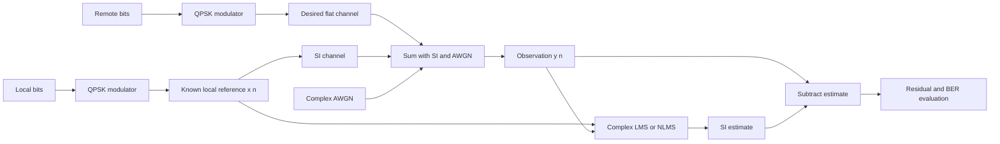
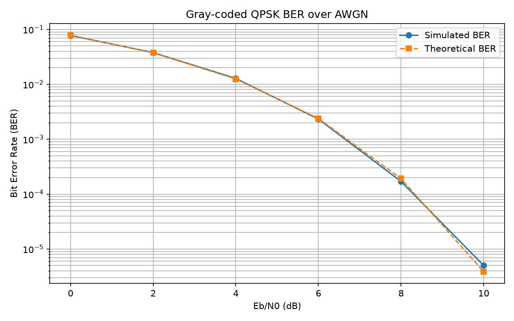
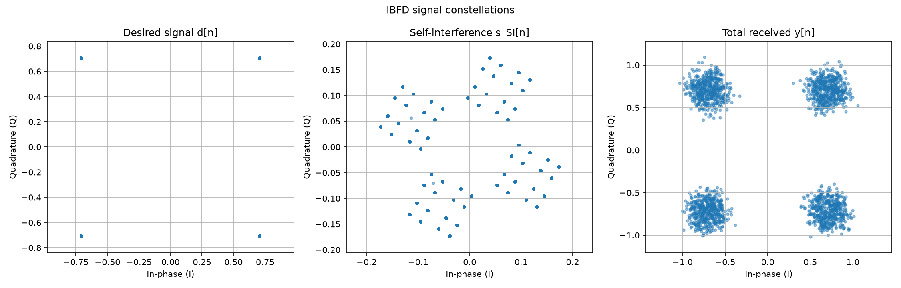
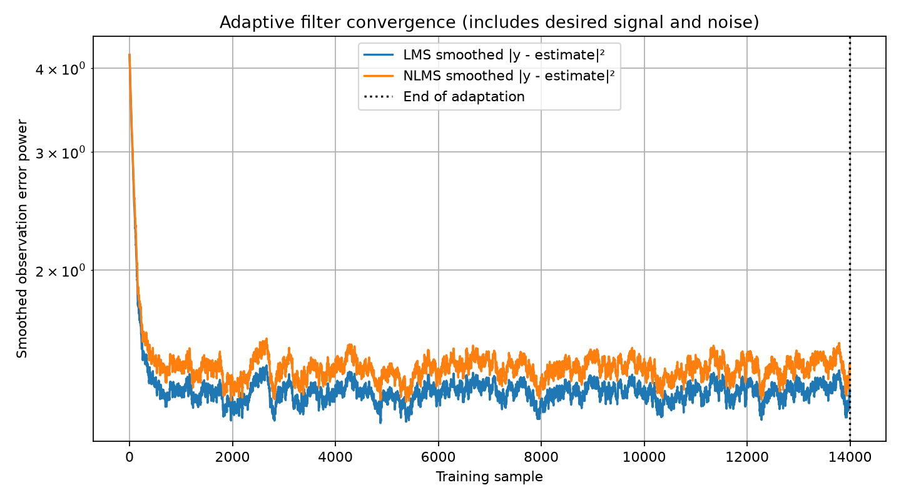
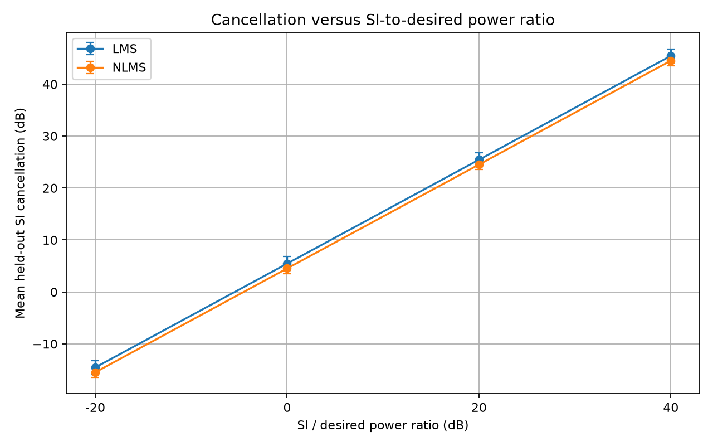
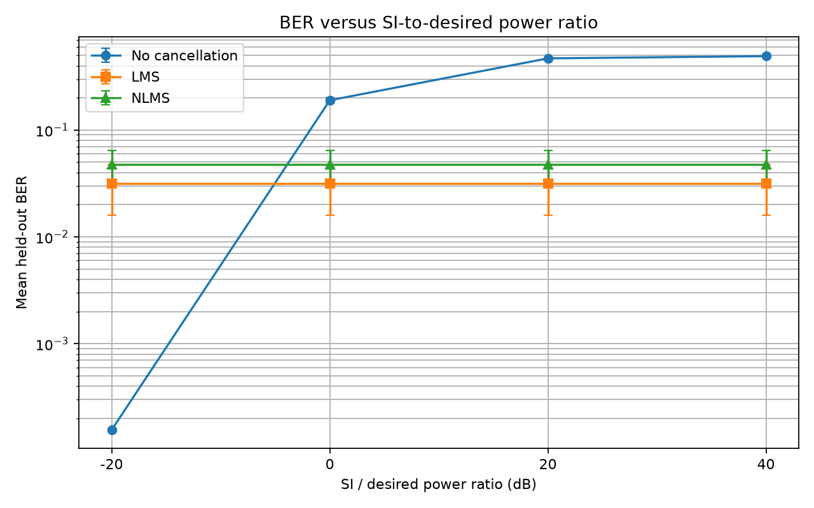

# Deep Learning-Based Self-Interference Cancellation for In-Band Full-Duplex Communication Using SDR

**B.Tech Electronics and Communication Engineering (ECE) final-year project — pre-project implementation**

This repository contains a reproducible, symbol-rate complex-baseband study of QPSK transmission, in-band full-duplex (IBFD) self-interference (SI) modelling, and conventional complex LMS/NLMS cancellation. It establishes the measured simulation baseline for planned deep-learning and software-defined-radio work. Current outputs are software simulations; no SDR/USRP hardware measurements are included.

## Research motivation and problem statement

An IBFD radio transmits and receives at the same time in the same frequency band. Its local transmit signal can couple into its receiver as self-interference, potentially masking a weaker remote desired signal. The research problem is to model that coupling and estimate its contribution from a known local transmit reference so that it can be subtracted before detection.

This pre-project builds the baseband link and a conventional adaptive-filter reference point. It provides reproducible signals, channel conditions, held-out metrics, and plots that later learned estimators can be compared against. Deep learning, GNU Radio, and SDR/USRP processing are planned work and are not implemented here.

## Project objectives

- Build and validate a Gray-coded QPSK communication chain over AWGN.
- Model an IBFD receiver with separate desired and local transmit paths.
- Implement complex linear LMS and NLMS SI estimation and subtraction.
- Measure held-out SI cancellation, residual SI power, BER, and convergence.
- Assess sensitivity to SI level, desired-referenced SNR, channel, filter length, and deterministic random seed.
- Preserve a modular baseline suitable for future comparative work.

## IBFD concept and signal model

The local transmitter and remote transmitter send independently generated QPSK symbol streams. The receiver observes:

$$y[n] = d[n] + s_{\mathrm{SI}}[n] + w[n]$$

where $d[n] \in \mathbb{C}$ is the desired remote signal after its configured flat complex gain, $s_{\mathrm{SI}}[n] \in \mathbb{C}$ is local signal leakage after the SI channel, and $w[n] \sim \mathcal{CN}(0, \sigma_w^2)$ is complex AWGN. Stage 2 offers a flat channel, a causal FIR multipath channel ($s_{\mathrm{SI}}[n] = \sum_{k=0}^{L-1} h[k]x[n-k]$), and a simplified memoryless cubic option. The Stage 3.5 sweeps use the flat and linear FIR cases.



The Stage 2 AWGN parameter is a **desired-signal-referenced SNR**, not $E_b/N_0$:

$$\mathrm{SNR}_{\mathrm{dB}} = 10\log_{10}\left(\frac{\frac{1}{N}\sum_{n}\vert{}d[n]\vert{}^2}{\mathbb{E}[\vert{}w[n]\vert{}^2]}\right)$$

The noise real and imaginary components each have half the specified complex noise power ($\sigma_w^2 / 2$ per quadrature dimension). Stage 1 QPSK-only calculations use $E_b/N_0$ separately and compare simulated BER with the coherent Gray-QPSK AWGN theory.

## Implemented methodology

### Stage 1 — QPSK over AWGN

Two bits map to one unit-energy Gray-coded complex symbol using `00` $\rightarrow \frac{1+j}{\sqrt{2}}$, `01` $\rightarrow \frac{-1+j}{\sqrt{2}}$, `11` $\rightarrow \frac{-1-j}{\sqrt{2}}$, and `10` $\rightarrow \frac{1-j}{\sqrt{2}}$. The receiver makes nearest-constellation hard decisions. The simulation calculates BER over a configurable $E_b/N_0$ sweep and compares it with the theoretical curve:

$$\mathrm{BER}_{\mathrm{theory}} = \frac{1}{2}\operatorname{erfc}\left(\sqrt{\frac{E_b}{N_0}}\right)$$



### Stage 2 — IBFD channel model

Separate seeded bit streams drive the remote desired path and known local transmit reference. The SI channel can be flat, causal FIR multipath, or the Stage 2 memoryless cubic baseband approximation. Multipath convolution assumes zero initial state and is cropped to the reference length so component arrays align. Configurable gains and taps are normalized simulation values, not measured RF coupling or calibrated hardware units.



### Stage 3 — complex LMS and NLMS baseline

For an adaptive filter of length $L$, the tap-input reference vector is $\mathbf{x}_n = [x[n], x[n-1], \ldots, x[n-L+1]]^T \in \mathbb{C}^L$ with zero-valued prehistory, and the adaptive weight vector is $\mathbf{w}_n \in \mathbb{C}^L$. The output convention and observation error are:

$$\hat{s}_{\mathrm{SI}}[n] = \mathbf{w}_n^H \mathbf{x}_n, \qquad e[n] = y[n] - \hat{s}_{\mathrm{SI}}[n]$$

The implemented complex weight updates are:

$$\mathbf{w}_{n+1} = \mathbf{w}_n + \mu \, \mathbf{x}_n \, e^*[n] \quad \text{(LMS)}$$

$$\mathbf{w}_{n+1} = \mathbf{w}_n + \frac{\mu}{\epsilon + \lVert\mathbf{x}_n\rVert_2^2} \, \mathbf{x}_n \, e^*[n] \quad \text{(NLMS)}$$

where $(\cdot)^H$ denotes Hermitian transpose, $e^*[n]$ is the complex conjugate of the error, $\lVert\mathbf{x}_n\rVert_2^2 = \mathbf{x}_n^H\mathbf{x}_n$, $\mu > 0$ is the step size, and $\epsilon > 0$ is a small regularization constant. The filter uses only the known local reference $\mathbf{x}_n$ and total observation $y[n]$; the desired signal $d[n]$ and noise $w[n]$ act as adaptation disturbances. In the standard configuration, weights are learned on a training prefix and frozen for held-out evaluation. True simulated SI is used only after filtering to measure $s_{\mathrm{SI}}[n] - \hat{s}_{\mathrm{SI}}[n]$. The plotted observation prediction error includes desired signal and noise; it is not labelled pure SI power.

For the fixed Stage 3 example (seed 21, 40,000 bits, 14,000 training symbols and 6,000 held-out symbols), measured results were:

| Method | Held-out SI cancellation | Residual SI power | BER before | BER after |
|---|---:|---:|---:|---:|
| No cancellation | 0.0000 dB | 1.11139 | 0.24450 | 0.24450 |
| LMS | 7.0845 dB | 0.217477 | 0.24450 | 0.0130833 |
| NLMS | 5.4240 dB | 0.318758 | 0.24450 | 0.0350000 |



### Stage 3.5 — systematic robustness experiments

`robustness_experiments.py` runs one-factor-at-a-time paired sweeps with 16,000 bits (8,000 symbols) per trial and deterministic seeds 11, 22, and 33. Each trial is split chronologically into 60% training, 20% validation, and 20% held-out test. LMS and NLMS receive identical transmit reference and observation for each trial; both freeze weights after training. Hyperparameters are fixed before the sweep. Validation values are retained for later parameter selection, while the reported headline metrics use the untouched test suffix.

**SI-to-desired power ratio:** the target is defined over the complete finite record before adding noise as:

$$\mathrm{SIR}_{\mathrm{target,dB}} = 10\log_{10}\left(\frac{\sum_n \vert{}s_{\mathrm{SI}}[n]\vert{}^2}{\sum_n \vert{}d[n]\vert{}^2}\right)$$

Conditions are $-20$, $0$, $+20$, and $+40\text{ dB}$. The same four-tap multipath response is scaled by one positive real factor at each condition, preserving the relative complex taps. Desired-referenced SNR is held at $20\text{ dB}$.

**Noise sweep:** desired signal power divided by complex AWGN power, as defined above, at $0$, $10$, $20$, and $30\text{ dB}$. This is not $E_b/N_0$ and is not referenced to the total received signal. At a given seed the same standard-normal noise sequence is reused and its variance is scaled to the configured SNR.

**Channel and filter sweeps:** channel comparisons include a flat complex gain and 2-, 4-, 8-, and 16-tap multipath channels. The fixed base multipath shape is $h[k] = 0.65^k e^{j 0.43 k}$; channel sweeps target $0\text{ dB}$ SI/desired power. The filter-length sweep uses 2, 4, 8, and 16 adaptive taps on the eight-tap channel. Step sizes are fixed across all experiments ($\mu_{\mathrm{LMS}} = 0.06$, $\mu_{\mathrm{NLMS}} = 0.6$, $\epsilon = 10^{-8}$); they are not claimed to be universally stable or individually optimized.

Cancellation is calculated for each seed on held-out test samples $\mathcal{N}_{\mathrm{test}}$ as:

$$\mathrm{Cancellation}_{\mathrm{dB}} = 10\log_{10}\left(\frac{\sum_{n \in \mathcal{N}_{\mathrm{test}}} \vert{}s_{\mathrm{SI}}[n]\vert{}^2}{\sum_{n \in \mathcal{N}_{\mathrm{test}}} \left\vert{}s_{\mathrm{SI}}[n] - \hat{s}_{\mathrm{SI}}[n]\right\vert{}^2}\right)$$

and then averaged in dB across seeds. Residual SI power is averaged in linear units. BER is computed per seed against the bit sequence aligned with the held-out symbol interval, then summarized by mean and sample standard deviation ($\text{mean} \pm \text{SD}$). Zero BER is retained as zero in datasets and displayed at half-bit resolution only where a logarithmic plot requires a positive value.

Selected measured test-set means (± sample standard deviation across three seeds):

| Sweep condition | LMS cancellation (dB) | LMS BER after | NLMS cancellation (dB) | NLMS BER after |
|---|---:|---:|---:|---:|
| SI/desired -20 dB | -14.54 ± 1.35 | 0.03167 ± 0.01566 | -15.48 ± 0.98 | 0.04781 ± 0.01660 |
| SI/desired 0 dB | 5.46 ± 1.35 | 0.03167 ± 0.01566 | 4.52 ± 0.98 | 0.04781 ± 0.01660 |
| SI/desired +20 dB | 25.46 ± 1.35 | 0.03167 ± 0.01566 | 24.52 ± 0.98 | 0.04781 ± 0.01660 |
| SI/desired +40 dB | 45.46 ± 1.35 | 0.03167 ± 0.01566 | 44.52 ± 0.98 | 0.04781 ± 0.01660 |
| Desired SNR 0 dB | 2.63 ± 1.23 | 0.21104 ± 0.00375 | 1.39 ± 0.97 | 0.22344 ± 0.00516 |
| Desired SNR 20 dB | 5.46 ± 1.35 | 0.03167 ± 0.01566 | 4.52 ± 0.98 | 0.04781 ± 0.01660 |
| Filter length 4 | 8.38 ± 0.75 | 0.00365 ± 0.00095 | 4.43 ± 3.07 | 0.06698 ± 0.05270 |
| Filter length 16 | 0.70 ± 1.79 | 0.14438 ± 0.04330 | 3.86 ± 1.61 | 0.06594 ± 0.02889 |

These are actual simulation results for the specified seeds and settings, not hardware measurements or a general ranking of LMS versus NLMS. In the weak-SI condition, the uncancelled link had zero observed test BER, while adaptation introduced errors; this is consistent with desired/noise leakage when the SI reference contribution is small. In the SI sweep, residual SI estimation error was similar in absolute power as SI amplitude changed, so cancellation in dB rose with SI level. The full table includes all channel/filter/noise points, BER before, residual SI power, and standard deviations.





## Results directory

Plots are committed by stage so that they render in GitHub's README preview:

- `results/stage1/`: transmitted/received constellations, I/Q samples, BER curve.
- `results/stage2/`: IBFD constellation and I/Q figures plus compressed component arrays.
- `results/stage3/`: baseline convergence, cancellation, BER, constellation plots and component arrays.
- `results/stage3_5/`: sweep figures, raw per-seed and aggregate CSV, convergence CSV, and compressed numeric arrays.

The Stage 3.5 default results are small enough to retain in Git and allow inspection without rerunning. `.venv`, Python bytecode, and Matplotlib caches are excluded.

## Installation and execution

Python 3.10+ is recommended. From the repository root in PowerShell:

```powershell
python -m venv .venv
.\.venv\Scripts\Activate.ps1
python -m pip install -r requirements.txt
```

Run the individual stages and complete validation:

```powershell
python qpsk_communication.py
python ibfd_simulation.py
python adaptive_si_cancellation.py
python robustness_experiments.py
python -m unittest discover -s tests -v
```

The scripts write plots and result arrays into their corresponding `results/stageN/` directory. Stage 3.5 runs the multi-seed sweeps and can take around half a minute on the reference environment. NumPy and Matplotlib are the only direct dependencies.

## Repository layout

```text
FYP/
├── README.md
├── LICENSE
├── requirements.txt
├── .gitignore
├── qpsk_communication.py
├── ibfd_simulation.py
├── adaptive_si_cancellation.py
├── robustness_experiments.py
├── docs/
│   └── project_overview.md
├── tests/
│   ├── test_qpsk.py
│   ├── test_ibfd.py
│   ├── test_adaptive_si.py
│   └── test_robustness_experiments.py
└── results/
    ├── stage1/
    ├── stage2/
    ├── stage3/
    └── stage3_5/
```

The four source modules remain at the repository root so the existing direct execution commands and tests continue to import them without packaging changes.

## Current Project Status

Stages **1, 2, 3, and 3.5 are implemented** and the full automated test suite contains 32 passing tests. The project has reproducible software simulations and a conventional held-out LMS/NLMS baseline. It is not yet a complete wireless transceiver and has not been validated with RF hardware.

## Current limitations

- Symbol-rate complex baseband only; no pulse shaping, oversampling, timing recovery, carrier synchronization, or coding.
- Static illustrative gains and FIR channels; no measured SI channel, RF front end, oscillator, ADC/DAC, clipping, AGC, or calibrated power units.
- AWGN is ideal and desired-referenced. SI/desired ratios are simulation scaling targets, not hardware isolation values.
- LMS and NLMS are linear adaptive FIR filters. They are not general nonlinear cancellers. For ideal constant-modulus QPSK, the Stage 2 memoryless cubic term $x[n]|x[n]|^2$ is proportional to $x[n]$; this special case does not model general PA nonlinearity.
- Stage 3.5 uses three seeds and finite test blocks. Its sample standard deviations are descriptive, not strong confidence intervals. Fixed step sizes may suit some channel lengths better than others.
- No deep-learning model, GNU Radio flowgraph, or USRP interface is implemented.

## Future Work

The planned final project phase is to characterize more realistic SI behavior, build a deep-learning SI estimator, and compare it with LMS/NLMS using identical train/validation/test signals and metrics. Later work may add measured complex IQ data and GNU Radio/SDR/USRP integration. Those stages remain planned and are not claimed as completed.

## References

1. J. I. Choi, M. Jain, K. Srinivasan, P. Levis, and S. Katti, “Achieving Single Channel, Full Duplex Wireless Communication,” *Proceedings of ACM MobiCom*, 2010. [doi:10.1145/1859995.1859997](https://doi.org/10.1145/1859995.1859997).
2. D. Bharadia, E. McMilin, and S. Katti, “Full Duplex Radios,” *Proceedings of ACM SIGCOMM*, 2013. [doi:10.1145/2486001.2486033](https://doi.org/10.1145/2486001.2486033).
3. B. Widrow, J. McCool, and M. Ball, “The Complex LMS Algorithm,” *Proceedings of the IEEE*, vol. 63, no. 4, pp. 719–720, 1975. [doi:10.1109/PROC.1975.9807](https://doi.org/10.1109/PROC.1975.9807).
